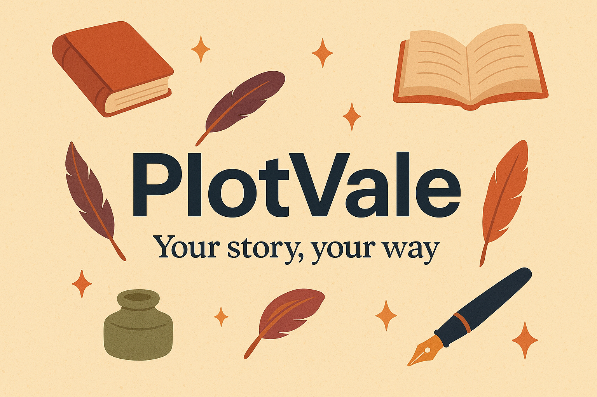

# PlotVale — the free anti-Scrivener, for real writers

[](https://github.com/EuropaVerse-studios/PlotVale/actions/workflows/ci.yml)
[](https://plotvale.readthedocs.io/en/latest/?badge=latest)
[](LICENSE-MIT)

**PlotVale** is a free and open-source program for organizing and writing novels,
short stories, and long-form texts: a libre alternative to Scrivener, written in
**pure Rust**, designed for **hobbyist writers** as well as seasoned novelists.

> An **independent project** inspired by the ArtCraft philosophy — free creative
> tools, open formats, no lock-in. Not affiliated with, endorsed by, or part of
> the ArtCraft team. See `ATTRIBUTION.md`.

## Why another writing app?

- **Free and open source, forever.** No subscriptions, no paid "pro" edition.
- **Zero lock-in**: your novel is a zip of plain-text files (Markdown + JSON) with
  a [public specification](docs/format-spec.md). You can still open it 20 years
  from now with Notepad.
- **Snapshots you can actually restore**, automatic backups, crash recovery.
- **Scrivenings-style continuous editing** across scenes, a live corkboard,
  writing goals, export to TXT / Markdown / HTML / DOCX / EPUB.
- **Bilingual interface (English + Italian)**, Italian typography («», —),
  language-aware word counting.

## Project status

Version **0.2.0** — working foundations (see `ROADMAP.md` for milestones):

- [x] Data model, `.plotvale` format, atomic saves, backups, crash recovery
- [x] Hierarchical binder, editor with inline Markdown styling, inspector, corkboard
- [x] Global search, snapshots, goals, statistics
- [x] TXT/Markdown/HTML/DOCX/EPUB export, `plotvale-cli`
- [ ] Typeset PDF (Typst), spell checking, Scrivener import

## Quick start

You need stable Rust ≥ 1.90 ([install via rustup](https://rustup.rs/)).

```sh
# graphical interface
cargo run -p plotvale

# command line: create, verify, stats, export
cargo run -p plotvale-cli -- new "My novel.plotvale" --title "My novel"
cargo run -p plotvale-cli -- stats "My novel.plotvale"
cargo run -p plotvale-cli -- verify "My novel.plotvale"
cargo run -p plotvale-cli -- export "My novel.plotvale" --format epub --out novel.epub

# quality gates (also enforced by CI on Windows, macOS, Linux)
cargo fmt --check
cargo clippy --workspace --all-targets -- -D warnings
cargo test --workspace
cargo run -p xtask -- check-locales
```

## Documentation

The full documentation is published on Read the Docs:
**<https://plotvale.readthedocs.io/>** — a 5-minute tour, the complete user guide, the
[format specification](docs/format-spec.md), the CLI reference, and the architecture notes.

Its sources live in [`docs/`](docs) and are plain Markdown built with Sphinx. To build
them locally:

```sh
python -m venv .venv
.venv/Scripts/pip install -r docs/requirements.txt   # Windows
.venv/bin/pip install -r docs/requirements.txt       # Linux / macOS
.venv/Scripts/python -m sphinx -b html docs docs/_build/html
```

## Repository layout

```
crates/model/     data model: tree, documents, sheets, goals, word counting
crates/project/   .plotvale reading/writing, atomic saves, backups, migrations
crates/search/    full-text index, regex, saved queries
crates/compile/   composition engine: selection → sections → blocks
crates/export/    TXT/Markdown/HTML/DOCX/EPUB renderers
crates/ui/        egui interface: binder, editor, corkboard, inspector
apps/plotvale/      desktop app (window)
apps/plotvale-cli/  command-line app
xtask/            automation (e.g. translation parity check)
locales/          interface strings (en.json, it.json) — the app stays bilingual
docs/             documentation sources (Sphinx, published on Read the Docs)
```

## Contributing

Contributions are welcome! Start from `CONTRIBUTING.md`, then `AGENTS.md` for the
project rules. Please open an issue before a pull request (typos and docs excepted).

## License

Dual-licensed at your choice: **MIT** or **Apache-2.0**
(`LICENSE-MIT`, `LICENSE-APACHE`). See `NOTICE` and `ATTRIBUTION.md`.
