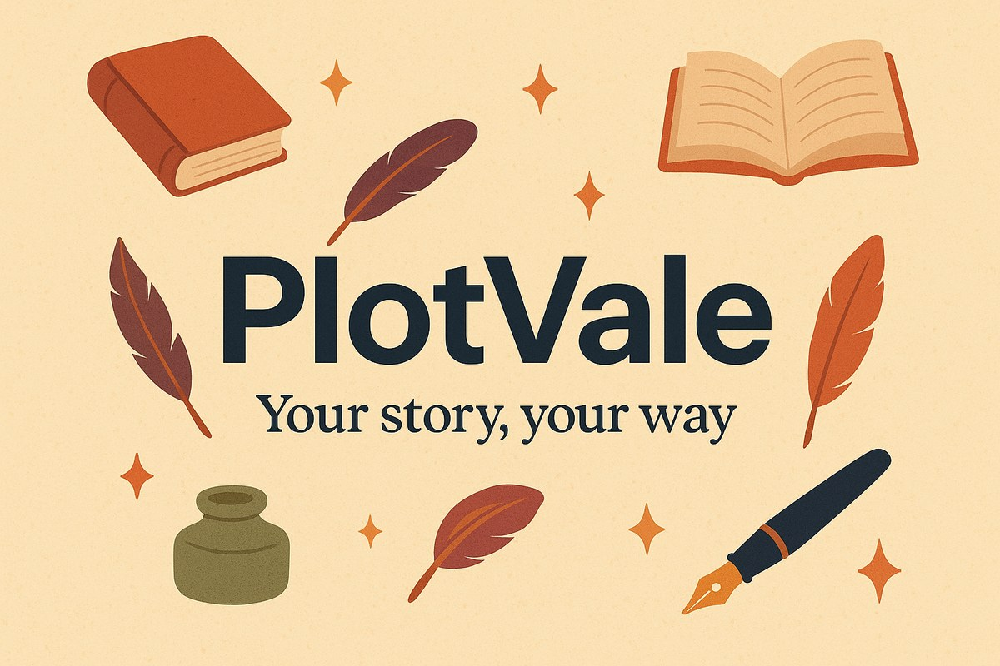

# PlotVale documentation

**PlotVale** is a free and open-source program for organizing and writing novels,
short stories, and long-form texts: a libre alternative to Scrivener with a
**Rust core** and a **React + Tauri desktop interface**, designed for hobbyist
writers as well as seasoned novelists.



The app interface is bilingual (English/Italian); these documentation pages are in
English, like the source comments and commit messages.

Where would you like to start?

- **[Getting started](getting-started.md)** — install PlotVale, create your first
  project, write your first scene.
- **[User guide](user-manual.md)** — the binder, the editor, the corkboard,
  snapshots, goals and export.
- **[Format specification](format-spec.md)** — the public `.plotvale` format: a zip
  of Markdown and JSON. No lock-in.
- **[Command line](cli.md)** — `plotvale-cli`: create, verify, inspect and export
  from the terminal.
- **[Architecture](architecture.md)** — how the crates fit together and which rules
  keep them independent.
- **[Contributing](contributing.md)** — build, test, and lint rules for a patch.

```{tip}
New to PlotVale? Read **[Getting started](getting-started.md)** first: it takes
five minutes and ends with text on the page.
```

## Why another writing app?

- **Free and open source, forever.** No subscriptions, no paid "pro" edition.
- **Zero lock-in**: your novel is a zip of plain-text files (Markdown + JSON) with
  a [public specification](format-spec.md). You can still open it in 20 years with
  Notepad.
- **Snapshots you can actually restore**, automatic backups, crash recovery.
- **Scrivenings-style continuous editing** across scenes, a live corkboard, writing
  goals, and export to TXT / Markdown / HTML / DOCX / EPUB.
- **Bilingual interface** (English + Italian), so the app speaks the language of the
  person writing.

## Project status

Version **0.2.0** — the working foundations are in place. The graphical app, the
CLI, the format, the composition engine, and the exporters all work today; what
comes next (typeset PDF, spell checking, Scrivener import) is tracked in the
[roadmap](roadmap.md).

```{note}
PlotVale is an **independent project**, inspired by the ArtCraft philosophy — free
creative tools, open formats, no lock-in. It is not affiliated with, endorsed by, or
part of the ArtCraft team. See [Licensing and attribution](licensing.md).
```

## These pages are generated

The site is built with [Sphinx](https://www.sphinx-doc.org/) and
[MyST](https://myst-parser.readthedocs.io/) and published with
[Read the Docs](https://readthedocs.org/). Pages such as the roadmap, the changelog,
and the attribution notice are **included from the repository root**, so there is only
one copy of each to keep up to date.

```{toctree}
:hidden:
:caption: Getting started

getting-started
```

```{toctree}
:hidden:
:caption: User guide

user-manual
user-guide/binder
user-guide/editor
user-guide/formatting
user-guide/scrivenings
user-guide/corkboard
user-guide/inspector
user-guide/snapshots
user-guide/search
user-guide/goals-and-statistics
user-guide/export
user-guide/backups-and-recovery
user-guide/settings
user-guide/keyboard-shortcuts
```

```{toctree}
:hidden:
:caption: Reference

format-spec
cli
```

```{toctree}
:hidden:
:caption: The project

architecture
development
contributing
roadmap
changelog
licensing
```
